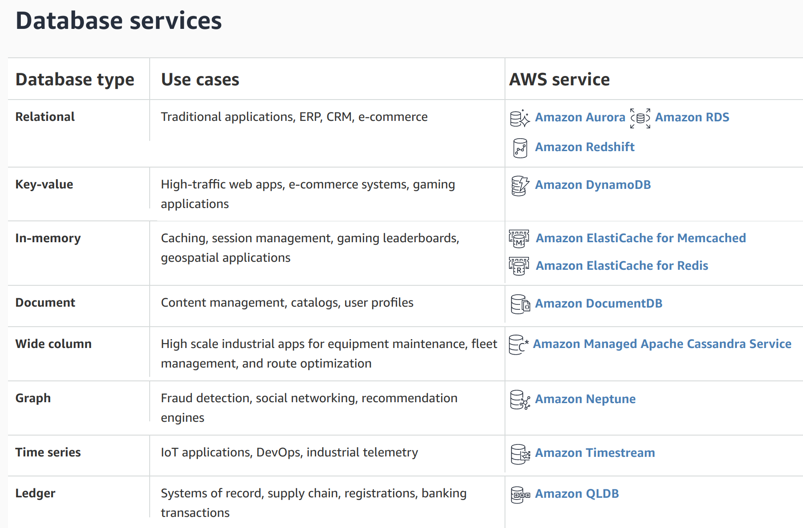
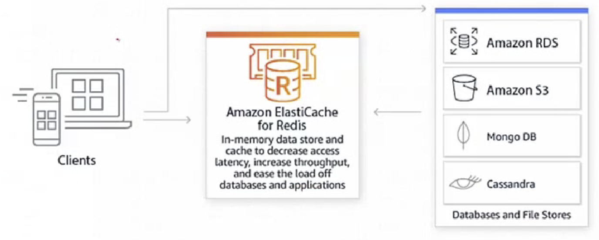

# AWS Database Server

 

#### Contents

- Database
- RDS (Relational Database Services)
- Amazon RDS for MySQL

 

#### Useful Informations

1. AWS provides a wide variety of relational and non-relational databases specifically built to accommodate specific application use cases
2. What AWS fully managed database services offer
   - `Relational databases` for transaction applications
   - `Non-relational databases` for Internet-scale applications
   - `Data warehouses` for analytics
   - `In-memory data stores` for caching and real-time workloads
   - `Graph databases` for building applications with highly interconnected data

 

 

## AWS Database

> Databases purpose-built for all application needs

- As storage and computing costs continue to decline thanks to the cloud, a new generation of applications has emerged, creating new requirements for databases
- Databases need to be able to store data at terabyte to petabyte scale, access data with millisecond latency, handle millions of requests per second, and scale to support millions of users worldwide
  - Both relational and non-relational databases purpose-built for specific application needs are required
- AWS provides a variety of databases purpose-built for specific application use cases
- When migrating existing databases to AWS, you can use `AWS Database Migration Service` for easy and cost-effective migration

 

### AWS Fully Managed Database Services

 

 

1.  **RDBMS** for Transaction application

2. **NoSQL** Internet size application

3. Data warehouse for analytics

4. In-memory store for caching & **real-time** workload

   

   - Real-time application use cases such as game leaderboards, app-based ride hailing, social media messaging, and online shopping require microsecond latency and high throughput
   - Rather than relying entirely on slower disk-based databases, you can improve real-time application performance by retrieving information from fast managed in-memory data stores and caches
   - `Amazon ElasticCache` is a `Redis` or `Memcached` compatible in-memory data store and caching service that supports easy deployment, operation, and scaling of in-memory data stores and caches in the cloud

5. `Graph database` for building applications with highly interconnected data

6. Time series database for measuring changes over time

7. Ledger database for maintaining and managing complete and verifiable transaction records

 

 

## Amazon Relational Database Service (RDS)

> Set up, operate, and scale a relational database in the cloud with just a few clicks

 

- Easily set up and operate RDBMS in the cloud
- Provides cost-effective and resizable capacity while automating time-consuming administrative tasks such as hardware provisioning, database setup, patching, and backups
- Supports users to focus on applications so they can deliver the performance, high availability (HA), security, and compatibility their applications need
- Amazon RDS is available in several database instance types (memory, performance, I/O optimization) and you can choose from 6 database engines including `Amazon Aurora`, `PostgreSQL`, `MySQL`, `MariaDB`, `Oracle Database`, and `SQL Server`
- You can migrate or duplicate existing databases to Amazon RDS using `AWS Database Migration Service`

 

 

## Amazon RDS Database Engine

 

### 1. Amazon Aurora

- A `MySQL` and `PostgreSQL` compatible RDBMS engine that combines the speed and availability of high-end commercial databases with the simplicity and cost-effectiveness of open source databases
- Delivers 5 times better performance than MySQL and provides the security, availability, and reliability of commercial databases at 1/10th the cost

 

### 2. Oracle

- With Amazon RDS, you can deploy multiple versions of Oracle Database in minutes with cost-effective and resizable hardware capacity
- You can bring your own existing Oracle license or pay license fees on an hourly basis
- RDS manages complex database administration tasks such as provisioning, backup, patching, monitoring, and hardware expansion, so users can focus on application development

 

### 3. (Microsoft) SQL Server

- Amazon RDS for SQL Server makes it easy to set up, operate, and scale SQL Server in the cloud
- You can deploy multiple versions of SQL Server including `Express`, `Web`, `Standard`, and `Enterprise`
- Amazon RDS for SQL Server provides direct access to the native capabilities of SQL Server, so your existing applications and tools should work without any changes

 

### 4. MySQL

- A very popular open source RDBMS used by many web applications
- You can use the code, applications, and tools already used in your existing database on Amazon RDS without any changes

 

### 5. PostgreSQL

- A powerful enterprise-grade open source RDBMS focused on extensibility and standards compliance
- Boasts various sophisticated features and can execute stored procedures in more than 12 programming languages including Java, Perl, Python, Ruby, Tcl, C/C++, and its own PL/pgSQL which is similar to Oracle's PL/SQL

 

### 6. MariaDB

- A MySQL-compatible database engine that is a fork of MySQL, developed by the original creators of MySQL
- With Amazon RDS, you can easily set up, operate, and scale MySQL deployments in the cloud
- With Amazon RDS, you can deploy a scalable MariaDB database in minutes with cost-effective and resizable hardware capacity

  

## Amazon RDS for MySQL

> Set up, operate, and scale RDBMS in the cloud with just a few clicks

 

- Amazon RDS supports MySQL Community Edition versions 5.5, 5.6, 5.7, and 8.0, so you can use Amazon RDS with your current code, applications, and tools
- Amazon RDS for MySQL complies with numerous industry standards
  - Standards compliance varies by region, so each needs to be researched individually!
- It meets **FedRAMP (Federal Risk and Authorization Management Program)** security requirements and has obtained a `FedRAMP HIGH Baseline` level Provisional Authority to Operate (**P-ATO**) from the FedRAMP Joint Authorization Board (JAB) within the **AWS GovCloud** (US-West) region
- Amazon RDS supports DB instances running multiple MySQL versions
  - MySQL 8.0
  - MySQL 5.7
  - MySQL 5.6
  - MySQL 5.5
- Users first create an **Amazon RDS MySQL DB instance** using Amazon RDS management tools or interfaces
- You can resize DB instances, authenticate connections to DB instances, create and restore backups or snapshots, create Multi-AZ secondaries, create read replicas, and monitor DB instance performance
- You can store data in and access data from DB instances using standard MySQL utilities and applications

 

 

#### Summary

: AWS Database provides services that can store data at terabyte to petabyte scale, access data with millisecond latency, handle millions of requests per second, and scale to support millions of users worldwide

