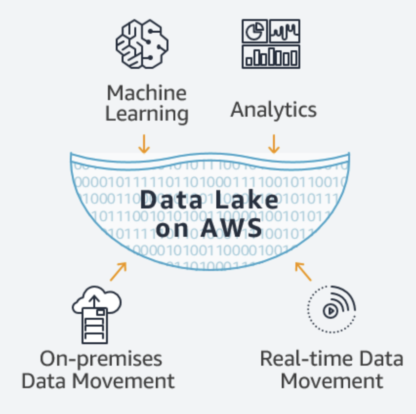
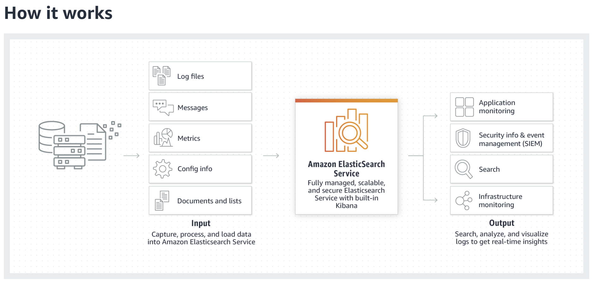
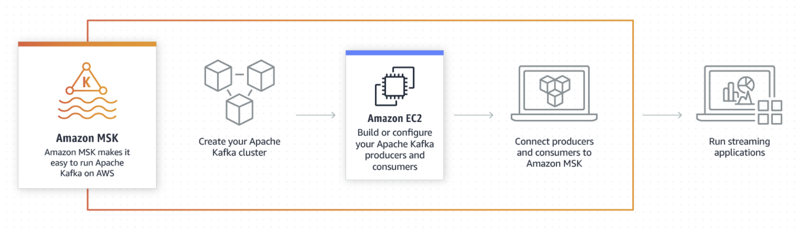

# AWS Analytics

 

#### Contents

- AWS Analytic Services

 

#### Useful Informations

1. AWS provides an integrated suite of services that offer everything needed to quickly and easily build and manage **Data Lakes** for analytics
   - It is the most comprehensive, secure, scalable, and cost-effective service portfolio for building Data Lake and analytics solutions
2. Amazon S3 is built to store and retrieve any type of data from anywhere — websites, mobile apps, enterprise applications, IoT sensors, data from devices, and more
   - Built with outstanding availability to store and retrieve any amount of data, it is designed to deliver 99.999999% durability

 

 

## AWS Analytics Services

 

### Data Lakes and Analytics on AWS

> The most comprehensive, secure, scalable, and cost-effective Service Portfolio for building Data Lake and Analytics Solutions

- AWS provides an integrated suite of services that offer everything needed to quickly and easily build and manage `Data Lakes (unrefined raw data)` for analytics
- Data Lakes on AWS can handle the scale, agility, and flexibility needed to gain deeper insights by combining various types of data and analytics techniques in ways that traditional `Data Silos (isolated local data)` and `Data Warehouses` cannot
- AWS provides customers with the broadest range of analytics and machine learning services for easy access to all relevant data without compromising security and governance

 

 

1. #### Data Movement

   : Import your data from on premises, and in real-time

2. #### Data Lake

   : Store any type of data securely, from gigabytes to exabytes

3. #### Analytics

   : Analyze your data with the broadest selection of analytics services

4. #### Machine Learning

   : Predict future outcomes, and prescribe actions for rapid response

 

 

### Data Lake

- Once data is ready for the cloud, you can easily and securely store data in any format at massive scale on AWS using `Amazon S3` and `Amazon Glacier`
- To make it easy for end users to find relevant data for analysis, `AWS Glue` automatically creates a single catalog that users can search and query

 

#### Storage - `Amazon S3`

> Amazon S3 is a secure, highly scalable object storage with millisecond latency for data access

- `S3 Select` reduces response time by up to 400% by focusing on **data reading and retrieval**
- S3 provides comprehensive security and compliance features that meet even the most stringent regulatory requirements

 

#### Backup & Archive - `Amazon Glacier`

> Amazon Glacier is a secure, durable, and extremely low-cost storage for long-term backup and archive where data can be accessed within minutes

- `Glacier Select` reads and retrieves only the data needed
- Customers can store data for as low as $0.004 per GB per month, offering significant cost savings compared to on-premises solutions

 

#### Data Catalog - `AWS Glue`

> AWS Glue is a fully managed service that provides a data catalog to make data in your data lake discoverable and performs **Extract / Transform / Load (ETL)** to prepare data for analytics

- The data catalog is automatically generated as permanent metadata storage for all data assets, making all data searchable and queryable

 

 

### Amazon Athena (Interactive Analytics)

> Amazon Athena is an interactive query service that makes it easy to analyze data in Amazon S3 using standard SQL

 

- Amazon Athena makes it easy to directly analyze data in S3 and Glacier using **standard SQL queries**
- Athena is **serverless**, so there is no infrastructure to set up or manage
- Query data instantly, get results within seconds, and only pay for the queries you run
- Simply point to your data stored in Amazon S3, define the schema, and start querying using standard SQL!
- Most results are delivered within a few seconds

 

 

### Amazon CloudSearch (Managed Search Service)

> Amazon CloudSearch is a managed service in the AWS Cloud that makes it simple and cost-effective to set up, manage, and scale a search solution for your website or application

- Amazon CloudSearch supports 34 languages and popular search features such as **highlighting**, **auto-complete**, and **geospatial** search

 

 

### Amazon EMR

> Easily run and scale Apache **Spark**, **Hadoop**, **HBase**, **Presto**, **Hive**, and other big data frameworks

#### Big Data

- Amazon EMR is a managed service that allows you to process large amounts of data easily, quickly, and cost-effectively
- Managed EMR Notebook for data engineering, data science development, and collaboration
- Each project is updated on EMR within 30 days of version release, making it easy to get the latest and best projects from the community

 

 

### Amazon Elasticsearch Service

> Amazon Elasticsearch Service is a fully managed service that makes it easy for you to deploy, secure, and run Elasticsearch cost effectively at scale

 

#### Operational Analytics

- For operational analytics such as application monitoring, log analysis, and clickstream analysis, Amazon Elasticsearch Service allows you to search, explore, filter, aggregate, and visualize data in near real-time
- Amazon Elasticsearch Service provides Elasticsearch's easy-to-use APIs and real-time analytics capabilities along with the availability, scalability, and security required for production workloads

 

#### Real-time Analytics

- `Amazon Kinesis` makes it easy to collect, process, and analyze **streaming data** such as IoT telemetry data, application logs, and website clickstreams
- Rather than waiting until all data is collected before processing, you can process and analyze data as it arrives in the data lake to respond in real-time

 

 

### Amazon Managed Streaming for Apache Kafka (Amazon MSK)

> Amazon MSK is a fully managed service that makes it easy for you to build and run applications that use Apache Kafka to process **streaming data**

 

 

- Apache Kafka is an **open-source platform** for building real-time streaming data pipelines and applications
- With Amazon MSK, you can use native **Apache Kafka APIs** to populate data lakes, stream changes to and from databases, and power machine learning and analytics applications
- With Amazon MSK, you can conveniently build and run production applications on Apache Kafka without expertise in managing Apache Kafka infrastructure
  - Spend less time on infrastructure management and more time on application development
- Apache Kafka is used as a data source for applications that continuously analyze streaming data and take relevant responsive actions

 

 

### Amazon Redshift

> The most popular and fastest cloud data warehouse

 

 

#### Data warehousing

- Amazon Redshift provides the capability to run complex analytical queries on petabytes of structured data
- Includes `Redshift Spectrum`, which runs SQL queries directly on structured and unstructured data in S3 without unnecessary data movement
- Amazon Redshift costs less than 1/10th of traditional solutions!
  - $0.25 per hour
  - $1,000 per year

 

 

### Amazon QuickSight

> Amazon QuickSight is a fast, cloud-powered business intelligence service that makes it easy to deliver insights to everyone in your organization

 

 

#### Fast Business Analytics Service & Dashboards and Visualizations

- For dashboards and visualizations, Amazon QuickSight provides a fast and powerful cloud-based business analytics service, making it easy to create visualizations and rich dashboards accessible from any browser or mobile device

 

 

### Amazon Data Pipeline

> AWS Data Pipeline is a web service that helps you reliably process and move data between different AWS compute and storage services, as well as on-premises data sources, at specified intervals

- With AWS Data Pipeline, you can regularly **access your data** where it's stored, **transform and process it at scale**, and efficiently **transfer the results to AWS services** such as Amazon S3, Amazon RDS, Amazon DynamoDB, and Amazon EMR
- AWS Data Pipeline helps you easily create complex data processing workloads that are fault tolerant, repeatable, and highly available
- You don't have to worry about ensuring resource availability, managing inter-task dependencies, retrying transient failures or timeouts in individual tasks, or creating a failure notification system
- AWS Data Pipeline also **allows you to move and process data** that was **previously locked up in on-premises data silos**.

 

 

### AWS Glue (Prepare and Load Data)

> AWS Glue is a fully managed extract, transform, and load (ETL) service that makes it easy for customers to prepare and load their data for analytics

 

#### Simple, Flexible, and Cost-effective ETL

- You can create and run an ETL job with a few clicks in the AWS Management Console
- You simply point AWS Glue to your data stored on AWS, and AWS Glue discovers your data and stores the associated metadata (e.g. table definition and schema) in the AWS Glue Data Catalog
- Once cataloged, your data is immediately searchable, queryable, and available for ETL

 

#### How It Works

1. Select data sources and data targets
2. AWS Glue generates ETL code in Scala or Python to extract data from the source, transform the data to match the schema, and load it into the target
3. Users can edit, debug, and test the code using the console, their preferred IDE, or notebook

 

### Use Cases

 

#### 1. Queries Against an Amazon S3 Data Lake

 

#### 2. Analyze Log Data in Your Data Warehouse

 

#### 3. Unified View of Your Data Across Multiple Data Stores

 

#### 4. Event-driven ETL Pipelines

  

### AWS Lake Formation

> AWS Lake Formation is a service that makes it easy to set up a secure data lake in days

 

 

- A data lake is a **centralized**, **curated**, and **secured** repository that stores all your data, both in its original form and prepared for analysis.
- A data lake enables you to break down `data silos` and combine different types of analytics to gain insights and guide better business decisions

- Creating a data lake with Lake Formation is as simple as defining data sources and what data access and security policies you want to apply
- `Lake Formation` then helps you
  - collect and catalog data from databases and object storage
  - move the data into your new [Amazon S3](https://aws.amazon.com/s3/) data lake
  - clean and classify your data using machine learning algorithms
  - secure access to your sensitive data

- Your users can access a centralized [data catalog](https://aws.amazon.com/glue/faqs/#AWS_Glue_Data_Catalog/) which describes available data sets and their appropriate usage
- Your users then leverage these data sets with their choice of analytics and machine learning services, like [Amazon Redshift](https://aws.amazon.com/redshift/), [Amazon Athena](https://aws.amazon.com/athena/), and (in beta) [Amazon EMR](https://aws.amazon.com/emr/) for Apache Spark
- Lake Formation builds on the capabilities available in [AWS Glue](https://aws.amazon.com/glue/).

 

#### How it works

- Identify existing data stores in S3 or relational and NoSQL databases, and move the data into your data lake
- Crawl, catalog, and prepare the data for analytics
- Then provide your users secure self-service access to the data through their choice of analytics services
- Other AWS services and third-party applications can also access data through the services shown
- Lake Formation manages all of the tasks in the orange box and is integrated with the data stores and services shown in the blue boxes.

 

 

 

#### Summary

- AWS provides an integrated suite of services that offer everything needed to quickly and easily build and manage Data Lakes for analytics
- Amazon S3 is a secure, highly scalable object storage with millisecond latency for data access
