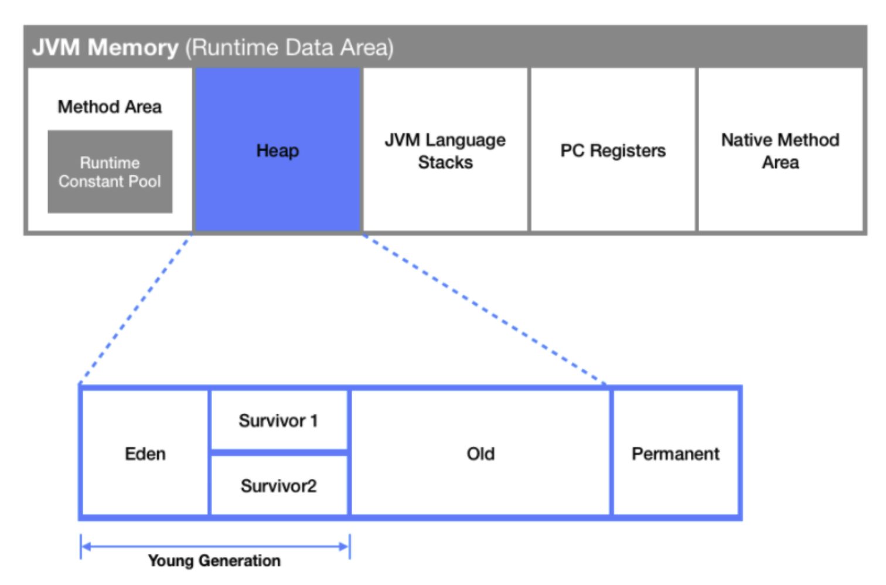

# GC

 

### What is GC?

- Objects stored in the `Heap` area during Java runtime will continue to accumulate if not cleaned up, potentially causing an `OutOfMemory Exception`
- To prevent this, the JVM periodically collects and cleans up unused objects through `Garbage Collection`

 

### Heap Area

- A virtual memory space for storing objects
- Stores objects and arrays created with the new operator

 

### Heap Structure

- `young` : Where relatively young references live
  - `eden`
    - Where freshly created references exist among the young generation
  - `survivor`
    - Two areas exist
    - Where references that survived eden temporarily reside
- `old` : Where references that have survived a certain number of times reside
- `permanent`: Where metadata information from the method area is recorded

 

### Minor GC and Major (Full) GC
>
> GC is classified as `Minor GC` or `Major GC` depending on the area where it is performed
>
- `Minor GC`
  - Deletes objects from the `Young Generation` (Eden and Survivor 1, 2) areas from memory
- `Major GC`
  - Among objects that were not deleted during the Minor GC process and were moved to the `Old Generation` area, those determined to be unused are deleted from memory
  - Causes
    - When the Old Generation area's memory is full and objects can no longer be allocated
    - When there are many objects in the Old Generation area that are no longer in use
    - When the application runs for a long time and objects in the Old Generation area are continuously created and destroyed
- Cautions
  - When a Major GC occurs, the JVM stops application execution to perform GC, which is called the `Stop-the-World` phenomenon
  - Since all threads are stopped, no further work is executed, and performance degrades
    - It is important to ensure GC runs at an appropriate frequency to reduce Stop-the-World time and minimize the time threads are stopped
