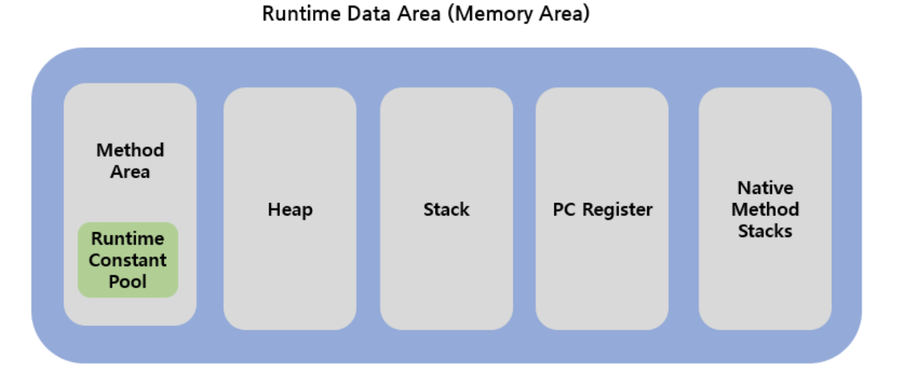

# Java Memory Area

 

### `Method Area`

- A space created when the JVM starts
- A space where Class information, global variable information, and Static variable information are stored
- `Runtime Constant Pool`
    - A space where constants are stored, as the name suggests
- Information is shared across all threads

### `Heap`

- A space where objects created with the new operator and dynamically created objects such as Arrays are stored
- Data stored in the Heap area is not destroyed unless processed by GC
- A space where `Reference Type` data is stored
- Information is shared across all threads

### `Stack`

- A space where temporarily used data such as local variables and method parameters are stored
- Has a `LIFO (Last In First Out)` structure, where data that entered last exits first
- If a local variable is a Reference Type, the address value of data stored in the Heap is stored in the Stack for use
- A space where `Primitive Type` data is stored
- One exists per Thread

### `PC Register`

- A space created when a Thread is created
- Registers the address of which instruction the Thread is processing
- Serves the role of storing the current position being executed by the JVM

### `Native Method Stack`

- A space used when execution of methods written in languages other than Java (C, C++) is needed
