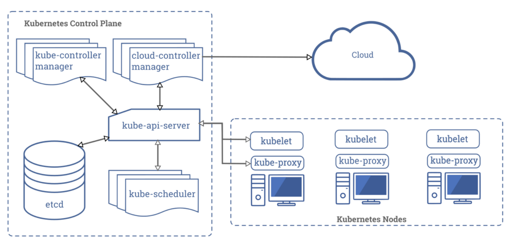
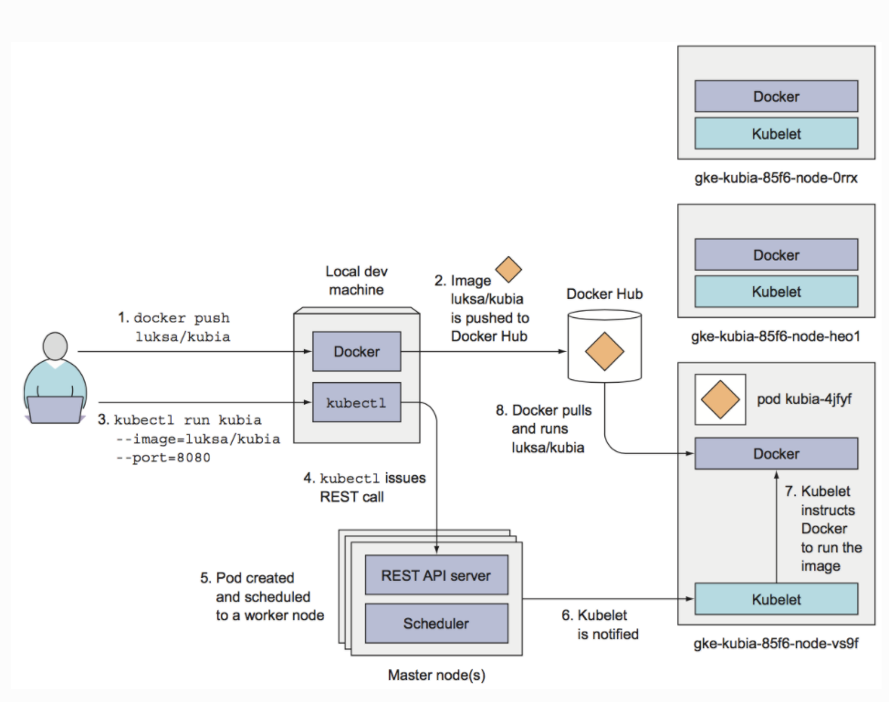
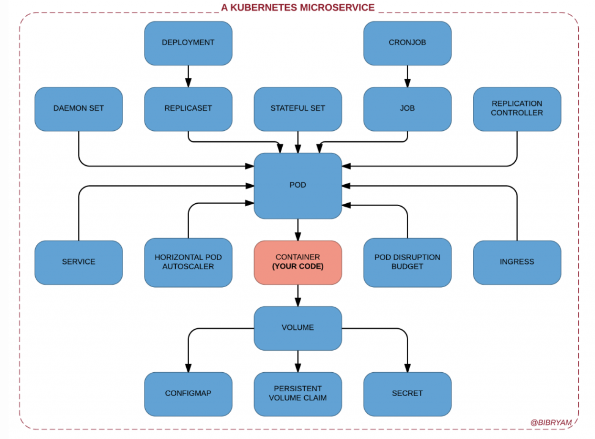
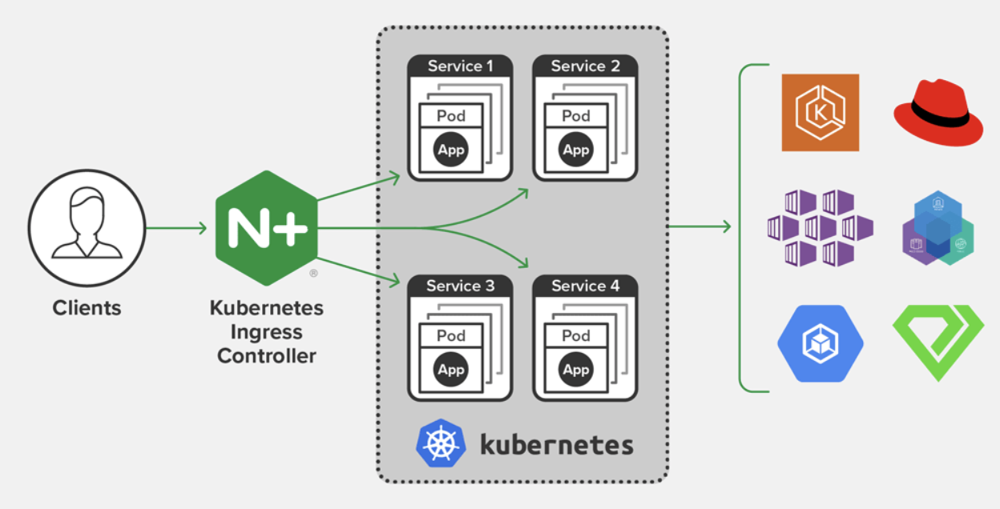

# Kubernetes Basics

 

 

### What is Kubernetes?

- Provides users with a framework for reliably operating distributed systems
- Handles service scaling requirements, failover, and deployment patterns
  - ex) Canary deployment

 

### What Kubernetes can do

- Service discovery and load balancing
- Storage orchestration
- Automated rollouts and rollbacks
- Automatic bin packing
- Self-healing
- Secret and configuration management

 

### Components of Kubernetes

- The `master` node controls/manages the entire Kubernetes system
- The `worker` node deploys the actual user applications

 

### Running app on Kubernetes

 

 

## Kubernetes Object

 

### Object Spec & Status

- Spec
  - Where you describe the desired status and characteristics that the object should have
  - This is what we configure
- Status
  - Describes the actual state of the object and is updated by the Kubernetes system

 

### Kubernetes object conceptual diagram

 

### 1. Pods

#### What is a Pod?

- The **minimum execution unit** of an application
- Contains information such as application containers (one or more), storage, network, etc.

 

#### Characteristics of a Pod

- Each Pod is assigned a unique private IP
- **Containers** inside a Pod share the Pod's **IP** as **localhost**
- A Pod can essentially be considered a virtual machine that holds the Pod

 

 

### 2. Deployments

- A resource that is higher-level than `ReplicaSet`
- The **basic unit** of **application deployment**

 

#### Required elements of a Deployments yml file

1. `apiVersion`
2. `kind`
3. `metadata`
4. `spec`
   - The state value that specifies the desired state in Kubernetes

 

 

### 3. labels

- Kubernetes selects specific resources based on labels
- Key-value pairs attached to objects such as pods

 

#### Labels Use Cases

- Used in `ReplicaSet` to point to specific running pods

 

 

### 4. Services: ClusterIP

- Exposes the Service through a cluster-internal IP
- Accessible only from within the cluster
- Accessible through kube-proxy
- Used for debugging services, accessing from a developer's local machine, or displaying internal dashboards

 

 

## Exposing Services Externally

>  Specify the type in the `manifest`

 

### 1. NodePort

- Exposes the service on a static port on each Node's IP using `NAT`
- Accessible from outside the cluster
  - `<NodeIP> : <NodePort>`
- 1 service per port
- Port range
  - 30000-32767

 

### 2. LoadBalancer

- An advanced type over NodePort
- Exposes the service externally using the cloud provider's Load Balancer
- NodePort and ClusterIP services (to which LB will route) automatically created
- Each service exposed via LB (ELB, NLB) has a unique IP address

 

### 3. Ingress

- Exposes services within the cluster via HTTP(S)
- Various implementations
  - ALB
  - Nginx
  - F5
  - HAProxy
- Default Service Type
  - ClusterIP

- Ingress is not a service type; it sits in front of services and refers to incoming network traffic from outside to inside the server

 

> Nginx Ingress controller example

 

 

### Volumes

- A disk that is bound to a Pod
- Since it is at the Pod level, it can be shared among multiple containers belonging to that Pod

 

### Namespace

- Provides a scope for k8s resources and a mechanism to apply permissions and policies to sub-sections of the cluster
  - In other words, it provides an opportunity to manage resources by grouping them
- Usage examples
  - Separating software environments such as development, testing, and production environments
  - Separating areas visible to the infrastructure team and the development team
    - Permission boundary
    - Resource boundary
- The following default namespaces are used when creating a cluster
  - `default`
    - The default namespace for objects that have no other namespace
    - Provides a scope for resources such as containers, pods, services, replicasets, etc.
  - `kube-system`
    - A namespace for objects created by the Kubernetes system
  - `kube-public`
    - Automatically created and accessible with read permissions by all users (including unauthenticated users)
    - Primarily reserved for resources that should be publicly visible and readable across the entire cluster
      - The public nature is merely a convention, not a requirement!
