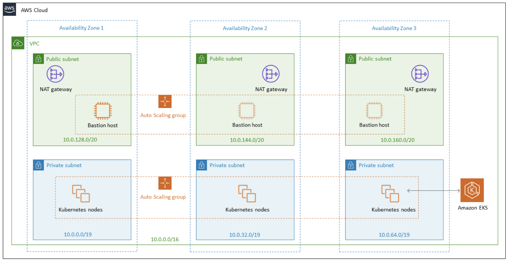

# EKS for Kubernetes

 

 

 

 

## Managed node groups

> Automates node provisioning and lifecycle management for Amazon EKS Clusters

- No need to separately provision or register Amazon EC2 instances
- Recently added support for Launch Template and Custom AMI
- When a specific version is released, previous versions become deprecated
-   .....

 

### Fargate

- Simply write and submit a Pod manifest, and the control plane manages everything automatically
- There may be security concerns, but it completely separates down to the hardware level

 

#### Advantages of using Fargate

- Different billing metrics can be applied per organization
- Per-Pod billing
  - The unit of management becomes the Pod!
    - Per-Pod access restrictions
    - Per-Pod network restrictions possible!
- ...

 

### Amazon VPC CNI Plugin

- ...

 

 

### Amazon EKS Ingress Controller

- When handling traffic, you need to distinguish between IP Mode and Instance Mode
  - This is possible because Amazon VPC CNI directly targets and uses IPs!

 

 

### IAM for Pods

- IAM permissions at the Pod level are possible
  - You can manage permissions per Pod!
- ...

 

 

## Logging and Monitoring

- Since the Control Plane is not accessible from the VPC..

 

### AWS App Mesh

- A service mesh that manages communication between services

 

### Amazon CloudWatch Container Insights

https://docs.aws.amazon.com/AmazonCloudWatch/latest/monitoring/ContainerInsights.html

  

## Hands-on

https://www.eksworkshop.com/020_prerequisites/k8stools/
