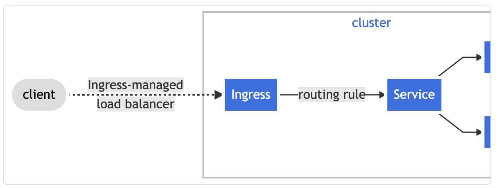

# What is Ingress?

> Let's learn about Kubernetes Ingress
>
> Reference: [Kubernetes docs](https://kubernetes.io/ko/docs/concepts/services-networking/ingress/)

<br>

<br>

## Ingress

<br>

- Generally, network traffic is classified into `ingress` and `egress`
  - Ingress is **incoming network traffic** from outside to inside the server
  - Egress is **outgoing network traffic** from inside the server to outside
- An API Object that manages external access to services within a cluster
  - Typically manages `HTTPS`
- Ingress can provide **load balancing**, **SSL termination**, and **name-based virtual hosting**

<br>

### Terms

- **Node**
  - Part of a cluster
  - A worker machine belonging to Kubernetes
- **Cluster**
  - A **set of nodes** that run **containerized applications** managed by Kubernetes
    - In most Kubernetes deployments, nodes in the cluster are not part of the `Public Internet`
-  **Edge Router**
  - A router that enforces firewall policies for the cluster
    - Could be a `Gateway` managed by a cloud provider or physical hardware
- **Cluster Network**
  - A set of logical or physical links that facilitate communication within the cluster according to the Kubernetes networking model
- **Service**
  - A Kubernetes service that identifies a set of `pods` using a `Label selector`
    - Unless otherwise mentioned, it is assumed that services have virtual IPs that are only routable within the `Cluster network`

<br>

### What is Ingress?

- Exposes **HTTP** and **HTTPS** routes from outside the cluster to services inside the cluster
- **Traffic routing** is controlled by rules defined on the Ingress resource



- Ingress can be configured to provide externally-reachable **URLs** for services, **load balance traffic**, **SSL/TLS** termination, and name-based virtual hosting services
  - An `Ingress controller` is typically responsible for fulfilling the Ingress using a load balancer, and it can also configure an **edge router** or **additional frontends** to help handle traffic
- Ingress does not expose arbitrary ports or protocols
  - To expose services other than HTTP and HTTPS to the internet, you typically use `Service.Type=NodePort` or `Service.Type=LoadBalancer`

<br>

### Prerequisites

- An `Ingress Controller` is required to fulfill an `Ingress`
  - Simply creating the resource has no effect! A controller is needed
- You need to deploy an **ingress controller** such as `ingress-nginx`, and there are various types of ingress controllers available

<br>

### The Ingress resource

> A minimal Ingress resource example

```yaml
# service/networking/minimal-ingress.yaml

apiVersion: networking.k8s.io/v1
kind: Ingress
metadata:
  name: minimal-ingress
  annotations:
    nginx.ingress.kubernetes.io/rewrite-target: /
spec:
  rules:
  - http:
      paths:
      - path: /testpath
        pathType: Prefix
        backend:
          service:
            name: test
            port:
              number: 80
```

- Like all other Kubernetes resources, an Ingress requires `apiVersion`, `kind`, and `metadata` fields
- The name of an Ingress object must be a valid **DNS subdomain name**
- Ingress frequently uses annotations to configure various options depending on the ingress controller, such as the **rewrite-target annotation**

- Different ingress controllers support different annotations
- The `Ingress spec` contains all the information needed to configure a load balancer or proxy server
  - Most importantly, it contains a list of rules that match incoming requests
    - The Ingress resource only supports rules for directing **HTTP(S) traffic**

<br>

### Ingress rules

: Each HTTP rule contains the following information

- **Optional host**
  - If a host is provided, the rules apply to that host
- **List of paths**
  - Each path in the list has an associated backend defined with `service.name`, `service.port.name` or `service.port.number`
    - Both the **host** and **path** must match the content of an incoming request before the load balancer directs traffic to the referenced service
- **Backend**
  - A backend is a combination of **service** and port name as described in the service docs or custom resource backends
    - HTTP(S) requests to the Ingress that match the host and rule path are sent to the listed backends

<br>

### DefaultBackend

- An Ingress with no rules sends all traffic to a single **default backend**
- The DefaultBackend is a configuration option of the `ingress controller` and is not specified in the `ingress resource`
- If no host or path matches the HTTP request of the `ingress object`, the traffic is **routed** to the **default backend**

<br>

### Resource Backend

- A `Resource backend` is an **ObjectRef** to another Kubernetes resource within the same namespace as the Ingress object
- A `Resource` is a mutually exclusive setting with **service**, and specifying both will fail **validation**
  - Validation will fail
- A common use of `Resource backend` is to ingest data into an **object storage backend** with static assets

<br>

> Resource backend example

```yaml
# service/networking/ingress-resource-backend.yaml

apiVersion: networking.k8s.io/v1
kind: Ingress
metadata:
  name: ingress-resource-backend
spec:
  defaultBackend:
    resource:
      apiGroup: k8s.example.com
      kind: StorageBucket
      name: static-assets
  rules:
    - http:
        paths:
          - path: /icons
            pathType: ImplementationSpecific
            backend:
              resource:
                apiGroup: k8s.example.com
                kind: StorageBucket
                name: icon-assets
```

- After creating the Ingress with the YAML file above, you can verify the created Ingress with the following command

  ```bash
  $ kubectl describe ingress ingress-resource-backend
  ```

  - Result

    ```bash
    Name:             ingress-resource-backend
    Namespace:        default
    Address:
    Default backend:  APIGroup: k8s.example.com, Kind: StorageBucket, Name: static-assets
    Rules:
      Host        Path  Backends
      ----        ----  --------
      *
                  /icons   APIGroup: k8s.example.com, Kind: StorageBucket, Name: icon-assets
    Annotations:  <none>
    Events:       <none>
    ```

<br>

### Path types

- Each path in an Ingress must have a corresponding path **type**
  - Paths that do not include an explicit `pathType` will fail **validation**!
- There are three supported path types
  1. `ImplementationSpecific`
     - Whether this path type matches depends on the **IngressClass**
       - Implementations can treat this as a separate `pathType`,
       - Or treat it like `Prefix` or `Exact` path types
  2. `Exact`
     - Matches the URL path with case sensitivity strictly
  3. `Prefix`
     - Matches based on a URL path prefix split by `/`
       - Matching is case-sensitive,
       - And done on a **path element** by element basis
     - A request matches path *p* if every element-wise prefix of the request path is *p*
       - However, it does not match if the last element of the path is a substring of the last element in the request path
         - ex)
           - `/foo/bar` matches `/foo/bar/baz`,
           - but `/foo/bar` does not match `/foo/barbaz`!

<br>

### Examples

| Type   | Path                            | Request Path    | Match                                        |
| ------ | ------------------------------- | --------------- | -------------------------------------------- |
| Prefix | `/`                             | (all paths)     | Yes                                          |
| Exact  | `/foo`                          | `/foo`          | Yes                                          |
| Exact  | `/foo`                          | `/bar`          | No                                           |
| Exact  | `/foo`                          | `/foo/`         | No                                           |
| Exact  | `/foo/`                         | `/foo`          | No                                           |
| Prefix | `/foo`                          | `/foo`, `/foo/` | Yes                                          |
| Prefix | `/foo/`                         | `/foo`, `/foo/` | Yes                                          |
| Prefix | `/aaa/bb`                       | `/aaa/bbb`      | No                                           |
| Prefix | `/aaa/bbb`                      | `/aaa/bbb`      | Yes                                          |
| Prefix | `/aaa/bbb/`                     | `/aaa/bbb`      | Yes, trailing slash ignored                  |
| Prefix | `/aaa/bbb`                      | `/aaa/bbb/`     | Yes, trailing slash matches                  |
| Prefix | `/aaa/bbb`                      | `/aaa/bbb/ccc`  | Yes, subpath matches                         |
| Prefix | `/aaa/bbb`                      | `/aaa/bbbxyz`   | No, string prefix does not match             |
| Prefix | `/`, `/aaa`                     | `/aaa/ccc`      | Yes, `/aaa` prefix matches                   |
| Prefix | `/`, `/aaa`, `/aaa/bbb`         | `/aaa/bbb`      | Yes, `/aaa/bbb` prefix matches               |
| Prefix | `/`, `/aaa`, `/aaa/bbb`         | `/ccc`          | Yes, `/` prefix matches                      |
| Prefix | `/aaa`                          | `/ccc`          | No, uses default backend                     |
| Mixed  | `/foo` (Prefix), `/foo` (Exact) | `/foo`          | Yes, Exact is preferred                      |

<br>

#### Multiple matches

- In some cases, multiple paths in an Ingress may match a request
  - In such cases, the longest matching path takes precedence
    - If two paths have the same length, the path with an `Exact` path type is used over one with a `Prefix` path type!


<br>

<br>`+`

- Kubernetes services balance **Pods** at the `L4 layer`, at the `TCP` level
