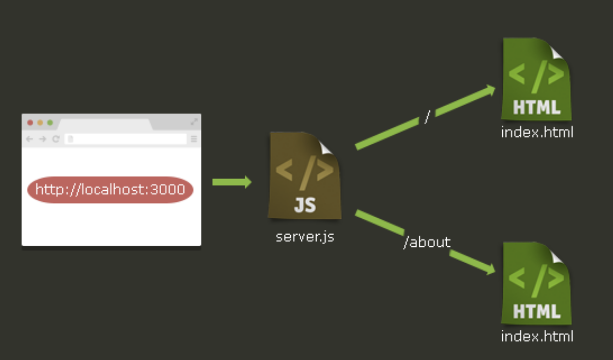
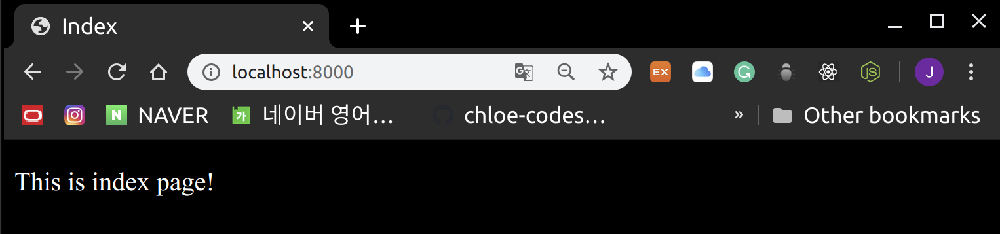
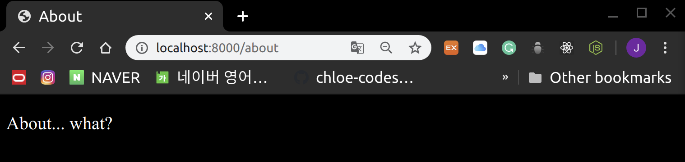

# Express.js Basics

<br>

<br>


<br>

<br>

### What is Express.js?

: Express is a minimal and flexible Node.js web application framework that provides a robust set of features to develop `web` and `mobile` applications.

<br>

#### Core Features

1. Allows to **set up middlewares** to respond to HTTP Requests

2. Defines a **routing table** which is used to perform different actions based on HTTP Method and URL
3. Allows to **dynamically render HTML Pages** based on passing arguments to templates

<br>

<br>

## Installation

<br>

### 1. Installing Express Locally

> Install express

```bash
npm install express --save
```

- saves the installation locally in the **node_modules**
- create a directory **express**  inside **node_modules**

<br>

> Express version check

```bash
$ npm view express version
4.17.1
```

<br>

> Install modules along with express

```bash
npm install body-parser --save
npm install cookie-parser --save
npm install multer --save
```

<br><br>

### 2. Installing Express in the Project

<br>

#### Directory structure

```
express_tutorial/
├── package.json
├── public
│   └── css
│   └── style.css
├── router
│   └── main.js
├── server.js
└── views
 ├── about.html
 └── index.html
```

<br>

#### 1. create package.json

```json
{
  "name": "express-tutorial",
  "version": "1.0.0",
  "dependencies":
  {
    "express": "~4.13.1",
    "ejs": "~2.4.1"
  }
}
```

<br>

<br>

#### 2. Install dependency by using `npm`

```bash
npm install
```

<br>

<br>

#### 3. Create `Express` server

> server.js

```javascript
var express = require('express');
var app = express()
var server = app.listen(8000, function(){
    console.log("Express server running on port 8000!")
})
```

<br>

> result

```bash
$ node server.js
Express server running on port 8000!
```

- When opening the web server on port 8000, the text `Cannot GET/` is displayed
  - why?
    - Because the `Router` hasn't been set up yet!

<br>

<br>

#### 4. Basic Routing

<br>

> server.js

```javascript
var express = require('express');
var app = express()
var server = app.listen(8000, function(){
    console.log("Express server running on port 8000!")
})

app.get('/', function(request, response){
    response.send('Hello World')
})
```

<br>

<br>

#### 5. Router

<br>



It is good coding practice to write router code and server code in separate files!

- Create a **router** folder
- Create `main.js`

<br>

> router > main.js

```javascript
module.exports = function(app){

    app.get('/', function(request, response){
        response.render('index.html')
    });

    app.get('/about', function(request, response){
        response.render('about.html')
    });
}

```

- `module.exports` allows the **router** code to be imported and used as a module in `server.js` since it was written separately~!

<br>

<br>

### 5. Render HTML page

<br>

- Create a **views** directory
- Create `html` files

<br>

> views > index.html

```html
<!DOCTYPE html>
<html lang="en">
<head>
    <meta charset="UTF-8">
    <meta name="viewport" content="width=device-width, initial-scale=1.0">
    <title>Index</title>
</head>
<body>

<p>This is index page!</p>
</body>
</html>
```

<br>

> views > about.html

```html
<!DOCTYPE html>
<html lang="en">
<head>
    <meta charset="UTF-8">
    <meta name="viewport" content="width=<device-width>, initial-scale=1.0">
    <title>About</title>
</head>
<body>
    <p>About... what?</p>
</body>
</html>
```

<br>

> Modify server.js

```javascript
var express = require('express');
var app = express();

// Import the router module main.js and pass app to it
var router = require('./router/main')(app);

// Define the location of HTML so the server can read it
app.set('views',__dirname + '/views');

// Set the server to use the EJS engine when rendering HTML
app.set('view engine', 'ejs');
app.engine('html', require('ejs').renderFile);

var server = app.listen(8000, function(){
    console.log("Express server has started on port 8000!!")
})
```

<br>

<br>

### Handling Static Files

<br>

#### Static Files

- `.js`, `css`, `image` files used in HTML
- To handle `Static files` on the **Server**, use the `express.static()` method!

<br>

1. Create a **public** directory
2. Create a **css** directory
3. Create `.css` files

<br>

> public > css > style.css

```css
body {
    background-color: black;
    color: white;
}
```

<br>

> Modify server.js

```javascript
// Set the public directory as the static folder
app.use(express.static('public'));
```

<br>

> Add CSS link to html files

```html
<link rel="stylesheet" href="css/style.css">
```

<br>

#### result

> 127.0.0.1:8000/



<br>

> 127.0.0.1:8000/about



<br>
