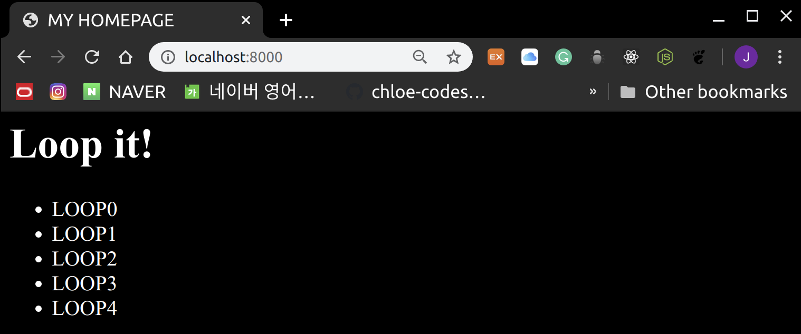

# EJS

<br>

### Directory Structure

```
Test02_EXPRESS/
├── data
│   └── user.json
├── node_modules
├── package.json
├── public
│   └── css
│       └── style.css
├── router
│   └── main.js
├── server.js
└── views
    ├── body.ejs
    ├── header.ejs
    └── index.ejs
```

<br>

<br>

## 1. Add dependency

<br>

### 1-1 Update `package.json`

> package.json

```json
{
  "name": "Test02_EXPRESS",
  "version": "1.0.0",
  "dependencies": {
    "ejs": "~2.4.1",
    "express": "^4.17.1",
    "body-parser":"~1.19.0",
    "express-session": "~1.17.0"
  }
}
```

- `body-parser`

  : Handles **POST** data

- `express-session`

  : Session management

<br>

> Install the modules

```bash
npm install
```

<br>

### 1-2 Update `server.js``

> server.js

```javascript
var express = require('express');
var app = express();

// Define the location of HTML so the server can read it
app.set('views',__dirname + '/views');

// Set the server to use the EJS engine when rendering HTML
app.set('view engine', 'ejs');
app.engine('html', require('ejs').renderFile);

var server = app.listen(8000, function(){
    console.log("Express server has started on port 8000!!")
})

// Set the public directory as the static folder
app.use(express.static('public'));

// Use body-parser
var bodyParser = require('body-parser');

// Use express-session
var session = require('express-session');
var fs = require('fs')

app.use(bodyParser.json());
app.use(bodyParser.urlencoded());
app.use(session ({
    secret: '@this#is#secret#key@',
    resave: false,
    saveUninitialized: true
}))

// Import the router module main.js and pass app to it
var router = require('./router/main')(ap,fs);
```

- `fs`
  - A **Node.js built-in module** imported to open files
- `secret`
  - A **sign** value for arbitrarily modifying cookies!
  - You can put any value you want
- `resave`
  - A value that determines whether to always save the session
  - The **express-session documentation** recommends setting this value to *false* and setting it to *true* as needed!
- `saveUninitialized`
  - An **uninitialized session** refers to a session that is newly created but not modified
  - The documentation recommends setting it to *true*!

<br>

<br>

## 2. EJS Template Engine

<br>

- A module that reads a template and converts the file to HTML format according to the engine's syntax and settings
- You can use `<% %>` in HTML to use server data or execute code!

<br>

#### Syntax

```html
<% JavaScript code %>
<% JavaScript object to output %>  => You can also receive JavaScript objects from the router!
```

<br>

### 2-1. Passing data to the VIEW

> main.js

```javascript
module.exports = function(app,fs){

    app.get('/', function(request, response) {
        response.render('index', {
            title: "MY HOMEPAGE",
            length: 5
        })
    });
}
```

- By passing `JSON data` as the second argument of the **render method**, the data becomes available on the page

<br>

<br>

### 2-2. Accessing data & looping in the VIEW

> views > index.ejs

```ejs
<html>
  <head>
  <title><%= title %></title>
    <link rel="stylesheet" type="text/css" href="css/style.css">
  </head>
  <body>
    <h1>Loop it!</h1>
    <ul>
        <% for(var i=0; i<length; i++){ %>
            <li>
                <%= "LOOP" + i %>
            </li>
        <% } %>
    </ul>
  </body>
</html>
```

<br>

> execute

```bash
node server.js
```

<br>

> result



<br>

<br>

### 2-3. Splitting EJS

> Just like in `PHP` or `Rails`, in `EJS` you can also split code into multiple files and import them!

<br>

#### Importing a File

```ejs
<% include FILENAME %>
```

<br>

> views > header.ejs

```ejs
 <title>
     <%= title %>
 </title>
 <link rel="stylesheet" type="text/css" href="css/style.css">
 <script>
    console.log("HelloWorld");
 </script>
```

<br>

> views > body.ejs

```ejs
<h1>Loop it!</h1>
<ul>
    <% for(var i=0; i<length; i++){ %>
        <li>
            <%= "LOOP" + i %>
        </li>
    <% } %>
</ul>
```

<br>

> Modify views > index.ejs!

```ejs
<html>
  <head>
    <% include ./header.ejs %>
  </head>
  <body>
    <% include ./body.ejs %>
  </body>
</html>
```

<br>

<br>

*This is fun!!!*
