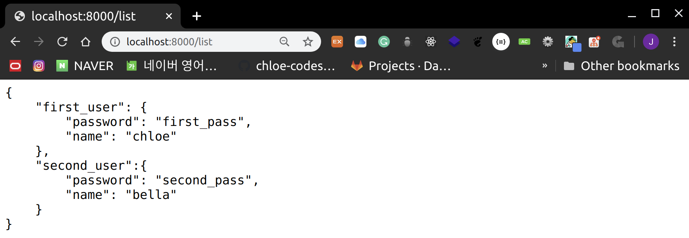
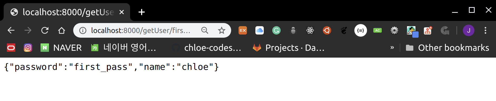

# RESTful API

<br>

<br>

## What is RESTful API?

- **R**epresentational
- **S**tate
- **T**ransfer

<br>

1. One form of `Software Architecture` for `Hypermedia systems` such as the WWW (World Wide Web)
2. A `REST Server` allows clients to access and modify server information using the **HTTP Protocol**
3. Information is provided in `text`, `xml`, `json` formats
   - Nowadays `json` is the mainstream!

<br>

<br>

## HTTP method

> 4 commonly used methods in REST-based architecture

<br>

1. **GET**

   : Retrieve

2. **PUT**

   : Create and `update`

3. **DELETE**

   : Remove

4. **POST**

   : Create

<br>

<br>

## Creating a Database

- Create a JSON-based user database

<br>

> Test04_RESTful > data > user.json

```json
{
    "first_user": {
        "password": "first_pass",
        "name": "chloe"
    },
    "second_user":{
        "password": "second_pass",
        "name": "bella"
    }
}
```

<br>

<br>

### 1. API: GET/list

- Create a `GET API` that outputs all user lists

<br>

> router > main.js

```javascript
module.exports = function(app,fs){

    app.get('/', function(request, response) {
        response.render('index', {
            title: "MY HOMEPAGE",
            length: 5
        })
    });
    app.get('/list', function(request, response){
        fs.readFile(__dirname + "../data/" + "user.json", "utf8", function(error, data){

            console.log(data);
            response.end(data);
        })
    })
}
```

- `__dirname`
  - Represents the location of the current module
  - Since the **router** module is inside the router folder, you need to use a relative path to access the data folder!

<br>

> After running the server, access <http://localhost/list>



<br>

<br>

### 2. API: GET/getUser/:username

- Create a `GET API` that retrieves detailed information for a specific username!

<br>

> Add to router > main.js

```javascript
   app.get('/getUser/:username', function(req, res){
       fs.readFile( __dirname + "/../data/user.json", 'utf8', function (err, data) {
            var users = JSON.parse(data);
            res.json(users[req.params.username]);
       });
    });
```

- After reading the file, it finds and outputs the user id
  - If the user is found, it outputs the user data
  - If not found, it outputs {}
- Since reading a file with `fs.readFile()` returns the data in text format, you need to use `JSON.parse()`!

<br>

> After restarting the server, access <http://localhost/getUser/first_user>



<br>

<br>

### 3. API: POST addUser/:username

#### body: { "password": "_****", "name": "****_" }

<br>

> Add to router > main.js

```javascript
app.post('/addUser/:username', function(req, res){

        var result = {  };
        var username = req.params.username;

        // CHECK REQ VALIDITY
        if(!req.body["password"] || !req.body["name"]){
            result["success"] = 0;
            result["error"] = "invalid request";
            res.json(result);
            return;
        }

        // LOAD DATA & CHECK DUPLICATION
        fs.readFile( __dirname + "/../data/user.json", 'utf8',  function(err, data){
            var users = JSON.parse(data);
            if(users[username]){
                // DUPLICATION FOUND
                result["success"] = 0;
                result["error"] = "duplicate";
                res.json(result);
                return;
            }

            // ADD TO DATA
            users[username] = req.body;

            // SAVE DATA
            fs.writeFile(__dirname + "/../data/user.json",
                         JSON.stringify(users, null, '\t'), "utf8", function(err, data){
                result = {"success": 1};
                res.json(result);
            })
        })
    });
```

- Returns an error if the `JSON` format is **Invalid**
- If **valid**, opens the file, checks for `username` duplication, then adds to the `JSON` data and saves again
- `stringify(users, null, 2)` is for JSON **pretty-print**

<br>

<br>

### 4. **API: PUT updateUser/:username**

#### **body: { "password": "_****", "name": "****_" }**

<br>

- An API that updates user information
- Uses the `PUT` method
  - An **idempotent** `PUT API`
    - Must guarantee the same result no matter how many times the request is made!

<br>

> Add to router > main.js

```javascript
app.put('/updateUser/:username', function(req, res){

        var result = {  };
        var username = req.params.username;

        // CHECK REQ VALIDITY
        if(!req.body["password"] || !req.body["name"]){
            result["success"] = 0;
            result["error"] = "invalid request";
            res.json(result);
            return;
        }

        // LOAD DATA
        fs.readFile( __dirname + "/../data/user.json", 'utf8',  function(err, data){
            var users = JSON.parse(data);
            // ADD/MODIFY DATA
            users[username] = req.body;

            // SAVE DATA
            fs.writeFile(__dirname + "/../data/user.json",
                         JSON.stringify(users, null, '\t'), "utf8", function(err, data){
                result = {"success": 1};
                res.json(result);
            })
        })
    });
```

<br>

<br>

### 5. **API: DELETE deleteUser/:username**

<br>

- An API that deletes user data
  - Uses the `DELETE` method

<br>

> Add to router > main.js

```javascript
app.delete('/deleteUser/:username', function(req, res){
        var result = { };
        //LOAD DATA
        fs.readFile(__dirname + "/../data/user.json", "utf8", function(err, data){
            var users = JSON.parse(data);

            // IF NOT FOUND
            if(!users[req.params.username]){
                result["success"] = 0;
                result["error"] = "not found";
                res.json(result);
                return;
            }

            // DELETE FROM DATA
            delete users[req.params.username];

            // SAVE FILE
            fs.writeFile(__dirname + "/../data/user.json",
                         JSON.stringify(users, null, '\t'), "utf8", function(err, data){
                result["success"] = 1;
                res.json(result);
                return;
            })
        })

    });
```
