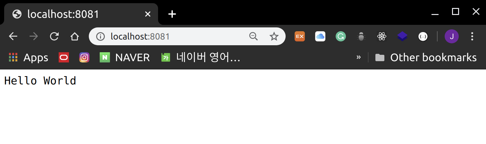

# Node.js - First Application

<br>

<br>

### Creating a Node.js Application

<br>

#### Step 1: Import the required modules

- Use the `require` command to load modules needed for the application

  ```javascript
  var http = require("http");
  ```

  - Loads the HTTP module and stores the returned HTTP instance in the http variable

<br>

<br>

#### Step 2: Create the Server

- Execute the `http.createServer()` method using the http instance created in Step 1
- Use the `listen()` method to bind with **port 8081**
- Pass a function with request and response as parameters to http.createServer()

<br>

> main.js

```javascript

var http = require("http");

http.createServer(function (request, response) {
    /*
        Send HTTP Header
        HTTP Status: 200 : OK
        Content Type: text/plain
    */
   response.writeHead(200, {'Content-Type': 'text/plain'});

   /*
       Set Response Body to "Hello World"
   */
   response.end("Hello World\n");
}).listen(8081);

console.log("Server running at http://127.0.0.1:8081");
```

- Creates a web server on port 8081 that always returns "Hello World"

<br>

<br>

#### Step 3: Test the Server

<br>

> Run the server

```bash
node main.js
```

<br>

> If the server starts successfully, the following text is output

```bash
Server running at http://127.0.0.1:8081/
```

<br>

> Open [http://127.0.0.1:8081/](http://127.0.0.1:8081/) in a browser to see the following result



<br>
