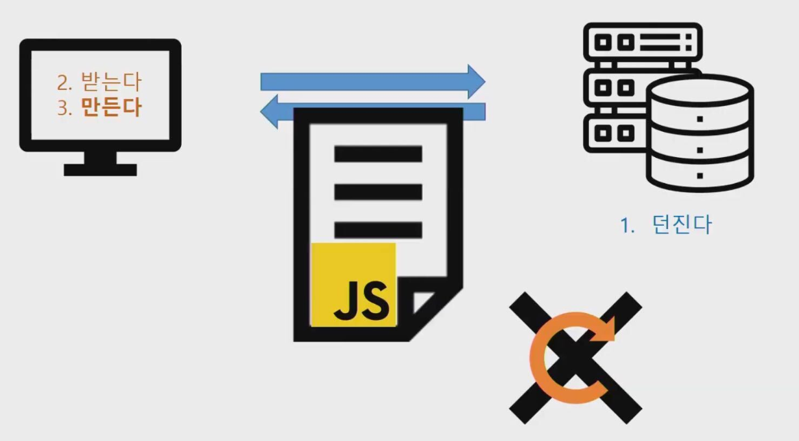
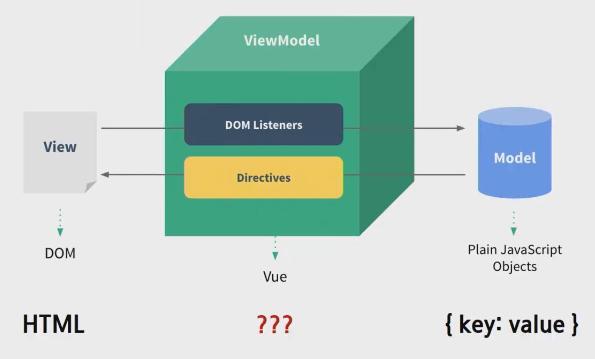
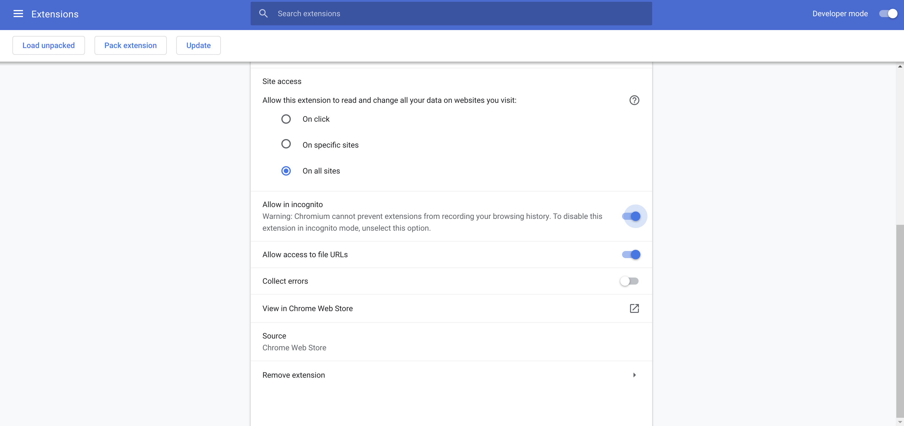

# Intro to Vue.js

> What, Why, and How

<br>

<br>

## 1. What is Vue.js?

> a **progressive framework** for building user interfaces

<br>

#### 1. Front End

<br>

#### 2. SPA (Single Page Application)

- A web application composed of a single page

- Instead of receiving the necessary data as HTML from the server side during page transitions (no server-side rendering), it dynamically renders by receiving only the necessary data from the server as JSON

  - client side rendering!

- Since the client holds all the HTML and only requests necessary data from the server side, receiving it as JSON, the speed of composing the screen is faster compared to traditional applications

- **Advantages**

  - Page transitions are fast because there is no need to render the entire screen each time.
  - The processing is efficient because only the necessary data for the screen is received and rendered.
  - It is convenient for users to use.

- **Disadvantages**

  - When loading the initial screen, it takes time because all screens must be prepared in advance.

  - It takes more time and is more complex to implement the application.

    Reference: [https://velog.io/@josworks27/SPA-%EA%B0%9C%EB%85%90](https://velog.io/@josworks27/SPA-개념)

<br>

#### 3. Client Side Rendering



<br>

#### 4. MVVN (Model View ViewModel) Pattern



- **Structure**
  - Model
    - The part that handles the data used in the application and its processing
  - View
    - The UI part that is shown to the user.
  - View Model
    - A Model created for the View, to represent the View
    - A Model for representing the View, and the part that processes data for displaying the View

- **Operation Sequence**
  - User Actions come through the View
  - When an Action enters the View, the Action is delivered to the View Model using the Command pattern
  - The View Model requests data from the Model
  - The Model responds with the requested data to the View Model
  - The View Model processes and stores the received data
  - The View displays the screen through Data Binding with the View Model

- **Advantages**

  - The MVVM pattern has no dependency between View and Model

  - It is also a design pattern that eliminates the dependency between View and View Model using the Command pattern and Data Binding

  - Since each part is independent, it can be developed in a modular fashion

    Source: <https://beomy.tistory.com/43> [beomy]

- **Vue.js** is a View-layer library corresponding to the ViewModel layer of the MVVM pattern

<br>

#### 5. Reactive

<br>

<br>

### Vue vs React

<br>

#### Similarities

- Utilizes a **Virtual DOM**
- Provides **reactive** and **composable** components
- Focuses only on the `core library`, with `companion libraries` for routing and global state management

<br>

`+`

Comparison of Vue.js with other frameworks

<https://kr.vuejs.org/v2/guide/comparison.html>

<br>

## 2. Why Vue.js?

1. Easy to learn!
2. $ (Cost savings)
   - Client Side Rendering
3. UX improvement
   - Asynchronous / SPA
4. Advantages of frameworks (franchise) (DX improvement - Developer Experience improvement)
   - No etc, focus and selection
   - Easy maintenance
   - Community and library

<br><br>

## 3. How?

<br>

### Setups

- VS Code

  - Install `Vetur`

- Chrome Web Store

  - `Vue.js devtools`

    - Select the following two options

    

- CDN

  - (For now) Use the development version above

  ```html
<!-- development version, includes helpful console warnings -->
  <script src="https://cdn.jsdelivr.net/npm/vue/dist/vue.js"></script>

  <!-- production version, optimized for size and speed -->
  <script src="https://cdn.jsdelivr.net/npm/vue"></script>

  ```

  <br>

<br>

### Docs

https://kr.vuejs.org/v2/guide/index.html

- Very well organized! Learn by following along!

<br>

<br>

## 4. Getting started with Vue.js

<br>

### 4-0. `el` attribute

- Specifies the point where the Vue instance will be rendered through the `el` property inside the Vue instance

ex)

> 00_el.html

```html
<body>
    <div id="app">

    </div>

    <script src="https://cdn.jsdelivr.net/npm/vue/dist/vue.js"></script>
    <script>
        // el is a property of the Vue instance
        const app = new Vue({
            el: '#app', // The section that determines which element to mount to
        })
        console.log(app)
        console.log(app.$el)
    </script>
</body>
```

<br>

### 4-1. `data` attribute

- Defines the data to be displayed on the screen

ex)

> 01_data.html

```html
<body>
    <div id="app">
    </div>
    <script src="https://cdn.jsdelivr.net/npm/vue/dist/vue.js"></script>
    <script>
        const app = new Vue({
            el:'#app',
            // How to declare Data
            data: { // The section responsible for the Model in MVVM
                message:'Hello Vue!'
            }
        })
        console.log(app.message)
    </script>
</body>
```

<br>

### 4-2. Interpolation

ex)

> 02_interpolation.html

```html
<body>
    {{ message }}
    <div id="app">
        {{ message }}
    </div>
    <script src="https://cdn.jsdelivr.net/npm/vue/dist/vue.js"></script>
    <script>
        const app = new Vue({
            el:'#app',
            data: {
                message:'Hello Vue!'
            }
        })
        console.log(app.message)
    </script>
</body>
```

<br>

### 4-3. `v-text`

- Same as Vanilla JS's DomElement.innerText
- Everything starting with the v- prefix is called a directive

ex)

> 03_v-text.html

```html
<div id="app">
        <p v-text="message"></p>
        <p> {{message}}</p>
    </div>
    <script src="https://cdn.jsdelivr.net/npm/vue/dist/vue.js"></script>
    <script>
        const app = new Vue({
            el:'#app',
            data: {
                message:'They are exactly the same!'
            }
        })
        console.log(app.message)
    </script>
</body>
```

<br>

### 4-4. `v-if`

- If the if evaluation is false, it does not appear on the screen

ex)

> 04_v-if.html

```html
<body>
    <div id="app">
        <p v-if="bool1">
            true
        </p>
        <p v-if="bool2">
            false
        </p>

        <p v-if="str1">
            'Yes'
        </p>
        <p v-if="str2">
            ''
        </p>

        <p v-if="num1">
            1
        </p>
        <p v-if="num2">
            0
        </p>

        <!-- JavaScript evaluates empty arrays as true -->
        <p v-if="arr">
            [] => In JS, an empty array evaluates to true
        </p>
        <p v-if="arr.length">
            Check if [].length is 0
        </p>
    </div>
    <script src="https://cdn.jsdelivr.net/npm/vue/dist/vue.js"></script>
    <script>
        const app = new Vue({
            el:'#app',
            data: {
                bool1: true,
                bool2: false,
                str1: 'Yes',
                str2: '',
                num1: 1,
                num2: 0,
                arr: [],
            }
        })
        console.log(app.message)
    </script>
</body>
```

<br>

### 4-5. `v-if`, `v-else-if`, `v-else`

ex)

> 05_v-if-elseif-else.html

```html
<body>
    <div id="app">
        <p v-if="username === 'master'">
            Hello Master
        </p>
        <p v-else>
            Hello User
        </p>

        <p v-if="number > 0">
            Positive
        </p>
        <p v-else-if="number < 0">
            Negative
        </p>
        <p v-else>
            0
        </p>
    </div>
    <script src="https://cdn.jsdelivr.net/npm/vue/dist/vue.js"></script>
    <script>
        const app = new Vue({
            el:'#app',
            data: {
             username: 'master',
             number: 0,
            }
        })
    </script>
</body>
```

<br>

### 4-6. `v-for`

ex)

> 06_v-for.html

```html
<body>
    <div id="app">
        <ul>
            <li v-for="number in numbers">{{ number +1 }}</li>
        </ul>

        <ol>
            <li v-for="teacher in teachers"> {{ teacher.name }}</li>
        </ol>
    </div>
    <script src="https://cdn.jsdelivr.net/npm/vue/dist/vue.js"></script>
    <script>
        const app = new Vue({
            el:'#app',
            data: {
                numbers: [0,1,2,3,4,5],
                teachers: [
                    { name: 'neo'},
                    { name: 'tak'},
                ],
            }
        })
    </script>
</body>
```

<br>

### 4-7. `v-bind`

- Used to connect standard HTML attributes with the Vue Instance (+ more)
- `v-bind:` can be abbreviated as `:`!

ex)

> 07_v-bind.html

```html
<body>
    <div id="app">
        <a href=" {{ googleUrl }}">Bad Google link</a>
        <a v-bind:href="googleUrl">Good Google link</a>
        <a :href="naverUrl">Naver link</a>
        
    </div>
    <script src="https://cdn.jsdelivr.net/npm/vue/dist/vue.js"></script>
    <script>
        const app = new Vue({
            el:'#app',
            data: {
                googleUrl: 'https://google.com',
                naverUrl: 'https://naver.com',
                randomImageUrl: 'https://picsum.photos/200',
                altText: 'random-image',
            }
        })
    </script>
</body>
```

<br>

### 4-8. `methods` attribute

ex)

>08_methods.html

```html
<body>
    <div id="app">
        {{ message }}
    </div>
    <script src="https://cdn.jsdelivr.net/npm/vue/dist/vue.js"></script>
    <script>
        const app = new Vue({
            el:'#app',
            data: {
                message:'Hello Vue!'
            },
            methods: {
                alertWarning: function() {
                    alert('WARNING!')
                },
                // Syntactic sugar: the above and below are exactly the same!
                alertMessage(){
                    alert(this.message)
                    // 'this' in the Vue world -> applied differently from JS
                    // : because the proxy system is applied internally
                },
                changeMessage(){
                    this.message = 'Changed message'
                }
            }
        })
    </script>
```

<br>

### 4-9 `v-on`

- Used to register a listener
- `v-on:` can be abbreviated as `@`!

ex)

> 09_v-on.html

```html
<body>
    <div id="app">
        <h1>{{ message }}</h1>
        <button v-on:click="alertWarning"> Alert Warning </button>
        <button v-on:click="alertMessage"> Alert Message </button>
        <button @click="changeMessage"> Change Message </button>
        <hr/>
        <!-- Event triggers when the enter key is pressed -->
        <input v-on:keyup.enter="onKeyUp" type="text">
    </div>
    <script src="https://cdn.jsdelivr.net/npm/vue/dist/vue.js"></script>
    <script>
        const app = new Vue({
            el:'#app',
            data: {
                message:'Hello Vue!'
            },
            methods: {
                alertWarning: function() {
                    alert('WARNING!')
                },
                alertMessage(){
                    alert(this.message)
                },
                changeMessage(){
                    this.message = 'Changed message'
                },
                onKeyUp(event) {
                    this.message = event.target.value
                }
            }
        })
    </script>
</body>
```

<br>

### 4-10. `v-model`

> Two-way binding only available for input, select, and textarea

- You can create two-way data bindings on form input and textarea elements using the `v-model` directive
- `v-model` is essentially **"syntax sugar"** that updates data on user input events
- `v-model` ignores the initial `value`, `checked`, and `selected` attributes of all form elements
  - It always treats the Vue instance data as the source of truth
  - You should declare the initial value in JavaScript inside the component's `data` option!

ex)

> 10_v-model.html

```html
<body>
    <div id="app">
        <h1> {{ message }}</h1>
        <!-- I want to completely synchronize user input <=> data! -->
        <!-- v-model => Two-way binding only available for input, select, textarea -->
        <hr/>
        <!-- One-way binding ( input => data )-->
        1way:
        <input @keyup="onInputChange" type="text">
        <hr/>
        <!-- Two-way binding ( input <=> data )-->
        2way:
        <input @keyup="onInputChange" type="text" :value="message" />
        <hr/>
        <!-- v-model -->
        v-model/2way:
        <input v-model="message" type="text">
    </div>
    <script src="https://cdn.jsdelivr.net/npm/vue/dist/vue.js"></script>
    <script>
        const app = new Vue({
            el: '#app',
            data: {
                message: 'hi',
            },
            methods: {
                onInputChange(event){
                    this.message = event.target.value
                }
            }
        })
    </script>
</body>
```

<br>

### 4-11. `v-show`

- **v-if** is advantageous when the evaluation (t/f) does not change frequently
- => Low initial rendering cost
- **v-show** is good when the evaluation (t/f) changes frequently
  - => Low toggle cost
  - v-show has it already prepared in the DOM, just with display set to none!

ex)

> 11_v-show.html

```html
<div id="app">
        <button @click="changeF">changeF</button>
        <p v-if="t">
            This is v-if with true
        </p>
        <p v-if="f">
            This is v-if with false
        </p>
        <p v-show="t">
            This is v-show with true
        </p>
        <p v-show="f">
            This is v-show wit false
        </p>
    </div>
    <script src="https://cdn.jsdelivr.net/npm/vue/dist/vue.js"></script>
    <script>
        const app = new Vue({
            el:'#app',
            data: {
                t: true,
                f:false,
            },
            methods: {
                changeF(){
                    this.f = !this.f
                }
            }
        })
    </script>
</body>
```

<br>

<br>

`+`

## Lodash

> A modern JavaScript utility library delivering modularity, performance & extras.
>
> <https://lodash.com/>

<br>

#### CDN

```html
<script src="https://cdnjs.cloudflare.com/ajax/libs/lodash.js/4.17.15/lodash.min.js"></script>
```

<br>
