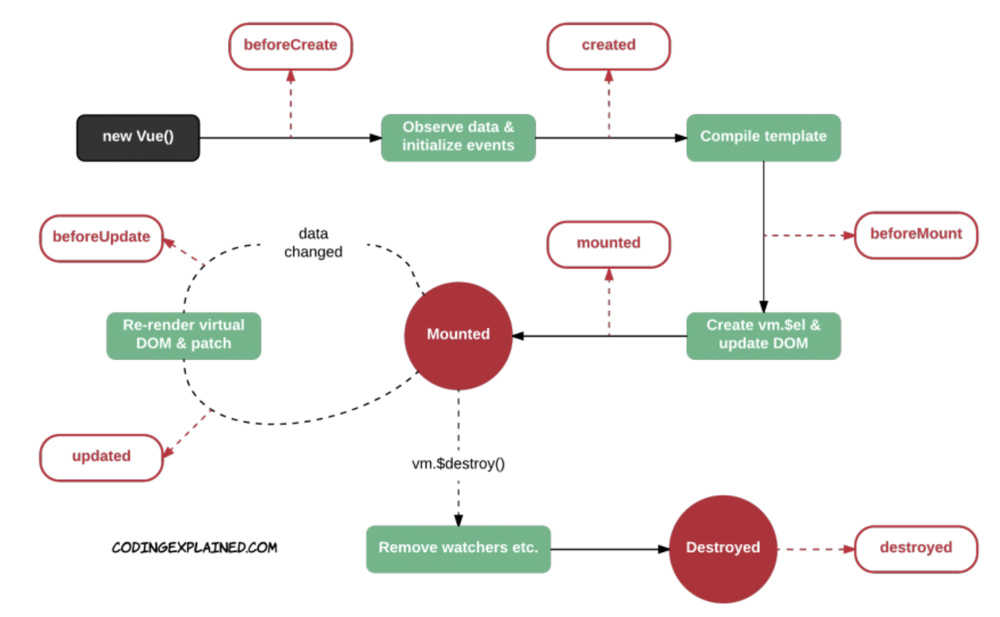

# Vue Intermediate

<br>

### Using JSONPlaceholder

> <https://jsonplaceholder.typicode.com/>

<br>

<br>

### Array concat vs spread operator vs push

> <https://www.measurethat.net/Benchmarks/Show/4223/0/array-concat-vs-spread-operator-vs-push>

<br>

<br>

## Vue instance lifecycle hooks



<br>

<br>

### Using Scrollmonitor

<br>

> cdn

```html
<script src="https://cdn.jsdelivr.net/npm/scrollmonitor@1.2.0/scrollMonitor.min.js"></script>
```

<br>

<br>

## Declarative vs Imperative

<br>

### Declarative

> Make me yusan-seul (a Korean dish)
>
> (The framework performs the procedure on your behalf -> Framework)

- Vue.js
  - Changes the UI according to data changes
  - UI phase (Hook)
- == django's url('/articles') -> views (list_article())
- == When JS code is first created (hook) -> function()

<br>

### Imperative (Procedural)

> Cook it yourself (when / what)
>
> Recipe (procedural)

- DOM EventListener

<br>

<br>

## `v-for:key`

- In order for Vue to track individual DOM nodes and reuse/reorder existing elements, you need to provide a unique key attribute for each item in `v-for`
- You must use `v-bind` to bind to dynamic values
- Unless the repeated DOM content is simple or you intentionally rely on default behavior for performance gains, it is recommended to always add a `key` to `v-for` whenever possible!

ex)

```html
      <li v-for="todo in todoByStatus()" :key="todo.id :class="{isCompleted: todo.completed}">
        <input type="checkbox" v-model="todo.completed">
        {{ todo.content }}
      </li>
```

<br>

<br>

### When `v-for` and `v-if` exist on the same node

- `v-for` has higher priority than `v-if`, and `v-if` is executed on every loop iteration.
- However, according to the Vue official documentation, it is recommended to avoid using both directives together.
  - It is recommended to use `v-if` wrapping around `v-for`

<br>

<br>

## `watch` vs `computed`

<br>

- #### `watch (angular)`

  - A hook that watches for data changes
  - When specific data changes, it changes data & renders
  - imperative

- #### `computed`

  - Does not separately watch for data changes,
  - When the framework detects that data has changed, it changes data & renders
  - declarative
    - What you would have to write yourself with watch, the framework does for you with computed!!

<br>

<br>

`+`

## Same Origin Policy & Cross Origin Resource Sharing

> Information is contained in the header

<br>

### Same Origin Policy

- Same Server resource (origin)

<br>

### Cross Origin Resource Sharing (CORS)

- Whether to allow things coming from a different source
