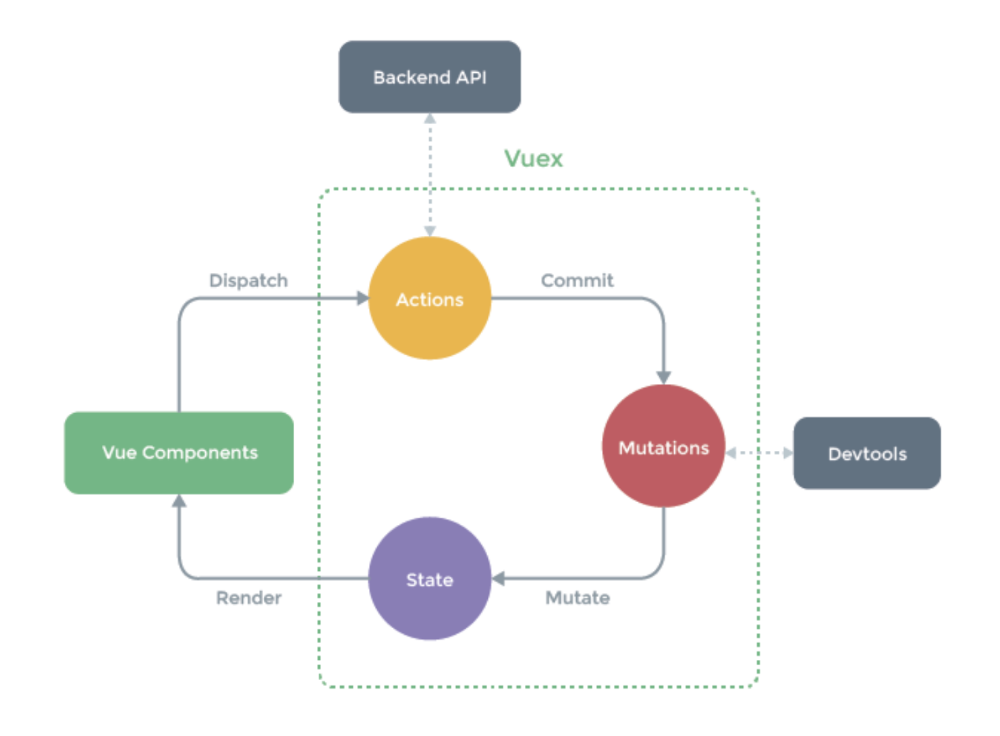

# Vuex

<br>

## What is Vuex?

> <https://vuex.vuejs.org/>

<br>

- A **state management pattern** + **library** for applications
- It serves as a `centralized store` for all the components in an application, allowing state to be changed in a predictable manner

<br>

<br>

## When Should I Use It?

<br>

- Vue has a **one-way data flow** => simplicity
  - If there are **multiple components** sharing a **common state**, the simplicity degrades
    - The shared state must be extracted from the components and managed as a global **singleton**!
      - This allows all components to **access** state or **trigger** actions regardless of where they are in the tree
  - It improves code **structure** and **maintainability** by defining and separating concepts related to state management and specific rule enforcement

<br>



<br>

- Vuex is useful for shared state management, but it can take longer to develop since you need to learn the concepts

- If the app is simple, it's not necessary, but for building **medium to large-scale SPAs**, it is recommended to use Vuex!
  - Refer to the `Flux` library!

<br>

<br>

## Four Properties of Vuex

<br>

### 1. `state`

- Can be seen as data in a Vue component
- Serves as the **source of truth**
- The **model** directly connected to the View
- Cannot be changed directly
  - Can only be changed through `mutations`
    - When state changes through mutations, the View is **reactively** updated

<br>

### 2. `mutations`

- The only way to change `state`
- Similar to **events**
- Implemented as functions
  - First argument: `state`
  - Second argument: `payload`
    - The payload can be an object containing multiple fields
- Generally cannot be called directly
  - Only possible through **commit**

<br>

### 3. `action`

- Similar to `mutation`, but unlike `mutation`, **asynchronous operations** are possible

- Can commit to mutations
- Can receive a **context** argument as the first argument
  - The **context** argument includes properties such as `state`, `commit`, `dispatch`, and `rootstate`
- The second argument can be received as a **payload**, same as mutations
- Can be called through **dispatch**
- In practice, it is used for making API calls through **Axios** and either returning the results or committing to mutations to change state

<br>

### 4. `getters`

- Same as **computed** in a Vue component
  - They are computed properties
- You can perform some operation on a specific state and bind the result to the View
- Depending on whether the state changes, the getter is recalculated and the View is updated as well
  - However, the state remains unchanged as the original data!

<br>

<br>

## Usage

<br>

> Add vuex

```bash
vue add vuex
```

<br>

<br>

<br>
